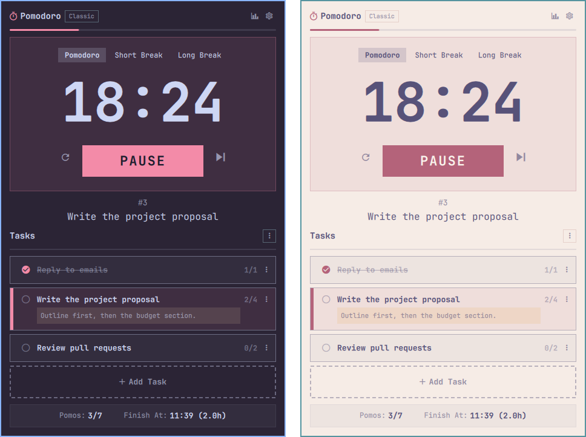

# Pomodoro for Omarchy

A [pomofocus.io](https://pomofocus.io)-style Pomodoro timer for the
[Omarchy](https://omarchy.org) bar. It has tasks, timer profiles, sounds,
notifications and a focus report, and it takes its colors from your Omarchy
theme.



## Features

- **Pomodoro / Short Break / Long Break**, with a long break every N
  pomodoros. START/PAUSE, reset, and a skip button that finishes the round
  early. A progress line shows how far along the round is.
- **Tasks**: add, edit, reorder, check off, add notes and estimate how many
  pomodoros each one needs. Click a task to make it the one the timer counts
  for. The footer shows `Pomos: done/estimated` and when you will finish at the
  current pace.
- **Profiles**: named timer setups such as *Classic* (25/5/15) and *Deep Work*
  (50/10/30). Make your own and switch with one click.
- **Settings** like pomofocus.io: auto-start breaks and pomodoros, long break
  interval, auto-check and auto-switch tasks, five alarm sounds with volume and
  repeat, ticking or white/brown noise while you focus, desktop notifications,
  a reminder before the end, and 12/24-hour time.
- **Report**: hours focused, days accessed, day streak and the last seven days.
- **Follows your theme**: panels, borders, buttons and fonts come from the
  active Omarchy theme. The three modes use the theme's own red, cyan and blue
  (or its accent color), and they change when you run `omarchy theme set`.
- **Never loses a round**: the end time is saved to disk, so suspend, shell
  restarts and plugin reloads don't lose or stretch a running round.

## Requirements

- Omarchy with the Quickshell-based `omarchy-shell` bar (Omarchy 4.x)
- `pw-play` for sounds. PipeWire ships it on Omarchy; `paplay` or `aplay` also
  work.

## Installation

### 1. Add the plugin

Run this in a terminal:

```sh
omarchy plugin add https://github.com/loneycoffee/omarchy-pomodoro.git --enable
```

Omarchy clones the repository into
`~/.config/omarchy/plugins/pomodoro`, asks you to confirm, and
then asks which bar section to put the widget in. Plugins run as normal code
inside your shell, so feel free to read the source before you confirm.

<details>
<summary>Installing by hand instead</summary>

```sh
git clone https://github.com/loneycoffee/omarchy-pomodoro.git \
  ~/.config/omarchy/plugins/pomodoro
omarchy-shell shell rescanPlugins
omarchy plugin enable pomodoro --section center
```

</details>

### 2. Place it in the bar (optional)

The widget is added to the end of the section you picked. To put it right next
to the clock:

```sh
omarchy bar move pomodoro --after omarchy.clock
```

### 3. Add keybindings (optional)

Add these lines to `~/.config/hypr/bindings.lua`. Hyprland reloads them when
you save.

```lua
o.bind("SUPER + ALT + P", "Pomodoro", "omarchy-shell shell toggle pomodoro")
o.bind("SUPER + ALT + SHIFT + P", "Pomodoro start/pause", "omarchy-shell pomodoro toggle")
```

Both combinations are free in the default Omarchy bindings. Check yours with
`omarchy menu keybindings --print`.

### 4. Check that it works

A timer icon appears in the bar. Right-click it to start a pomodoro; the bar
then shows the time left. If nothing shows up, run `omarchy restart shell`.

## Using it

### Bar

| | |
|---|---|
| Left click | Open the panel |
| Right click | Start / pause, without opening anything |

While a round is running, the bar shows the time left in the mode's color. To
show the time all the time, or never, change **Settings → Display → Bar label**.

### Panel

| Key | Action |
|---|---|
| `Space` / `Enter` | Start / pause |
| `n` | Finish the round early |
| `r` | Reset the round |
| `1` `2` `3` | Pomodoro / Short Break / Long Break |
| `j` / `k` | Select the next / previous task |
| `x` | Check off the selected task |
| `a` / `e` | Add a task / edit the selected task |
| `s` / `p` | Settings / report |
| `Esc` | Go back, then close |

- **Tasks:** click **Add Task**, type what you are working on, set the
  estimated pomodoros, and press `Enter`. The ⋮ button on a task opens it for
  editing (note, move up/down, delete). The ⋮ next to *Tasks* clears finished
  tasks, clears the pomodoro counts, or deletes every task.
- **Profiles:** open **Settings** (or click the profile name next to the
  title). Pick a profile, or use **New** to copy the current one. The *Timer*
  section edits the selected profile; every other setting applies to all
  profiles.
- **Pomodoro count:** click `#N` under the timer to reset it.

## Scripting

The plugin listens for IPC commands, which is handy for keybindings, scripts
and status bars:

```sh
omarchy-shell pomodoro toggle              # start / pause
omarchy-shell pomodoro start               # also: pause, skip, reset
omarchy-shell pomodoro mode short          # pomodoro | short | long
omarchy-shell pomodoro profile "Deep Work" # switch profile by name
omarchy-shell pomodoro addTask "Write the report"
omarchy-shell pomodoro show settings       # open on main | settings | report
omarchy-shell pomodoro status              # JSON, e.g. for scripts
```

`status` prints:

```json
{"mode":"pomodoro","state":"running","remaining":"18:24","remainingSeconds":1104,"pomodoro":3,"profile":"Classic","task":"Write the project proposal"}
```

## Updating

```sh
omarchy plugin update pomodoro
omarchy restart shell
```

The shell reloads plugin files when they change, but a running service can
keep its old code. Restarting the shell makes sure the update is in use.

## Uninstalling

```sh
omarchy plugin remove pomodoro
rm -rf ~/.local/state/omarchy/plugins/pomodoro   # tasks, profiles and report
```

## Troubleshooting

- **No sound**: check that `pw-play /usr/share/sounds/alsa/Front_Center.wav`
  plays something, and that the alarm volume in Settings isn't 0.
- **The keybinding does nothing**: the panel lives in the bar widget, so the
  widget has to be in the bar (`omarchy bar move pomodoro --after omarchy.clock`).
- **A change or update isn't showing**: `omarchy restart shell`.

## How it works

| File | What it does |
|---|---|
| `Service.qml` | The timer engine, loaded once for the whole shell. It handles state, rounds, sounds, notifications and IPC. |
| `BarWidget.qml` | The bar button and the popup (one per monitor, all showing the same timer) |
| `components/` | The panel's views: timer and tasks, settings, report |
| `Model.js` | Pure logic: defaults, time math, the *Finish At* estimate, the report |
| `bin/pomodoro-sound` | Plays a sound once or on a loop with `pw-play` |
| `tools/gen-sounds.py` | Generates the sounds in `sounds/` (Python standard library only) |

Your data is saved in
`~/.local/state/omarchy/plugins/pomodoro/state.json`.
Notifications go through `omarchy-notification-send`.

To regenerate the sounds after changing the generator:

```sh
python3 tools/gen-sounds.py
```

## Credits

Inspired by [pomofocus.io](https://pomofocus.io). This project isn't
affiliated with it.
